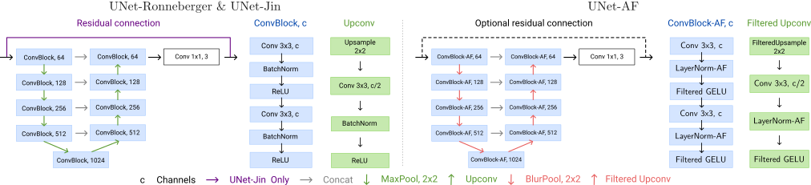

## UNet-AF: Alias-free UNet architectures<br><sub>Official PyTorch implementation</sub>

[](https://arxiv.org/abs/2603.11323)
[](https://github.com/jscanvic/UNet-AF)

<p align="center"></p>

<p align="center">UNet-AF Architecture</p>

**UNet-AF: Alias-free UNet architectures**<br>
[Jérémy Scanvic](https://jeremyscanvic.com), [Quentin Barthélemy](https://www.linkedin.com/in/quentin-b-b71a6788), [Julián Tachella](https://tachella.github.io)

Abstract: *The simplicity and effectiveness of UNet architectures make them ubiquitous in image restoration, segmentation, and diffusion models. They are often assumed to be equivariant to translations, yet they traditionally consist of layers that are known to be prone to aliasing, which hinders their equivariance in practice. To overcome this limitation, we show how to build sub-pixel translation-equivariant UNet architectures by appropriately choosing their main components (convolution, pooling, downsampling, activation, and normalization layers) to be alias-free. We evaluate the proposed equivariant architectures against non-equivariant baselines on image restoration tasks and observe competitive performance with a significant increase in measured equivariance. Through extensive ablation studies, we also demonstrate the importance of every architectural choice to achieve high equivariance.*

## Installation

Install the project using pip:

```bash
git clone https://github.com/jscanvic/UNet-AF
cd UNet-AF
pip install .
```

Run the post-install scripts to download the DIV2K dataset and generate the associated image restoration datasets, and to download the weights of the LPIPS backbone:

```bash
python -m post_install
python -m generate_datasets
```

Check that `datasets/DIV2K` contains the DIV2K images and that `datasets/DIV2K-Deblur` contains the associated image restoration datasets in the form of `.h5` (HDF5) files.

## Networks and layers

The implementation of UNet-AF and its faster variant (UNet-AF Fast) are located in [`unet_af/models/unet_af.py`](unet_af/models/unet_af.py). The alias-free layers are implemented in [`unet_af/layers.py`](unet_af/layers.py).

Our proposed CUDA kernel for efficient FIR filtered leaky-ReLU with periodic boundary conditions can be found in [`unet_af/ops/circular_filtered_lrelu`](unet_af/ops/circular_filtered_lrelu). It is adapted from the base implementation of [StyleGAN3](https://github.com/nvlabs/stylegan3) which handles zero-padded boundary conditions instead. A slightly modified copy of it is redistributed in [`unet_af/ops/stylegan3`](unet_af/ops/stylegan3) for the sake of simplicity.

## Equivariance metric

Our proposed metric to measure the equivariance of a UNet network to sub-pixel continuous translations can be found in [`unet_af/metrics/equiv.py`](unet_af/metrics/equiv.py) along with an implementation of periodic sinc translation in [`unet_af/metrics/continuous_translation.py`](unet_af/metrics/continuous_translation.py).

## Reproducing

### Training

To re-train one of the models from scratch, locate the associated training configuration in [`unet_af/configs`](unet_af/configs) and run the following command:

```bash
python train.py -c <config>.yaml
```

For example, to re-train a UNet-AF model for circular deblurring:

```bash
python train.py -c Main_UNet-AF.yaml
```

**Note:** Training requires a working installation of MLflow.

### Testing

To evaluate one of the pre-trained models, identify its name in the test configuration [`unet_af/test.yaml`](unet_af/test.yaml) and run the following command:

```bash
python test.py --subset <model_name>
```

For example, to test the UNet-AF model for circular deblurring:

```bash
python test.py --subset Main_UNet-AF
```

Optionally, you can evaluate multiple models at one using comma-separated wildcard patterns in `--subset`. It can also be omitted entirely to evaluate all of the models listed in [`unet_af/test.yaml`](unet_af/test.yaml).

The pre-trained weights are downloaded automatically from [🤗 Hugging Face](https://huggingface.co/jscanvic/unet-af).

### Stability metrics

Stability metrics can be computed separately from the training histories downloaded from [🤗 Hugging Face](https://huggingface.co/jscanvic/unet-af) using the following command:

```bash
python compute_stab.py
```

### Computing the UNet-AF Fast filter bank

The UNet-AF Fast filter bank can be computed using the following command:

```bash
python compute_filterbank.py
```

The pre-computed filter bank can be found at [`unet_af/filters/filterbank_128-8px_13taps.pt`](unet_af/filters/filterbank_128-8px_13taps.pt).

## Acknowledgements

Many of the layers used in the UNet-AF have been adapted from pre-existing implementations including [StyleGAN3](https://github.com/nvlabs/stylegan3), [Alias-Free Convnets](https://github.com/hmichaeli/alias_free_convnets), [Alias-Free ViT](https://github.com/hmichaeli/alias_free_vit).
The implementation of the UNet of Ronneberger et al. (2015) is adapted from [one of its PyTorch implementations](https://github.com/milesial/Pytorch-UNet), while that of Jin et al. (2017) is adapted from its implementation featured in the [DeepInverse library](https://deepinv.org).
This library is also used significantly for the downstream image restoration tasks (forward operator implementations, training and evaluation pipelines).

## Citation

If you find our code useful in your research, please consider citing us!

```
@article{scanvic2026unet,
  title={UNet-AF: An alias-free UNet for image restoration},
  author={Scanvic, J{\'e}r{\'e}my and Barth{\'e}lemy, Quentin and Tachella, Juli{\'a}n},
  journal={arXiv preprint arXiv:2603.11323},
  year={2026}
}
```